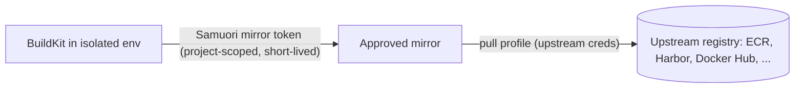

# Registry Authentication

Status: **Publication implemented for generic OCI registries (WP21) and Amazon ECR (WP27); build-time pulls of private
images through authorizing mirrors implemented (WP27).** Accepted as direction (ADR 0030, OD-13). Related: ADR 0024 (controller-only publication), ADR 0025 (mirror and
egress), [`registry-and-artifacts.md`](registry-and-artifacts.md). Threats: TM-59, TM-60 and TM-63 to TM-67.

## Two separate concerns

| Concern | Who authenticates | Credential holder | Seen by workers or steps |
|---|---|---|---|
| **Build-time pull** of private base images or OCI artifacts | The approved mirror, to upstream registries | Mirror (controller-side service) | Only a short-lived Samuori mirror token scoped to authorized repositories |
| **Publication** (push, promote, retag) | The controller | Controller | Never |

Registry authentication never uses the build-secret mechanism (ADR 0029), and build secrets are never used to
authenticate registries.

## Credential profiles (admin-managed)

| Type | Auth methods | Notes |
|---|---|---|
| `ecr` | Ambient workload identity (instance profile, web identity); STS AssumeRole with external ID, including cross-account; IAM Roles Anywhere | Records account ID and region. ECR authorization tokens last 12 hours; they are refreshed before expiry and cached in controller memory only |
| `oci-basic` | Username plus password secret reference | For registries without token services |
| `oci-token` | Access token or robot account secret reference | Harbor robot accounts, GitHub/GitLab tokens and similar |

Every profile has:
- a **Test** action using real connectivity, with explicit success or failure and its cause;
- **rotation**: a new secret version takes effect without downtime, and the old one is disabled;
- **purpose**: `pull` or `push`, never both;
- **scope**: allowed repositories or patterns;
- **authorization** of which teams and projects may use it;
- **audit** of creation, change, test, use and failure.

Least privilege for ECR: pull roles get only `ecr:GetAuthorizationToken`, `ecr:BatchGetImage` and
`ecr:GetDownloadUrlForLayer` on specific repositories. Push roles get only the push actions on specific
destination repositories. Repository creation is a separate, admin-only role (D03).

AWS accounts are never configured in the repository or the build environment. Administrators add them through the
admin portal (**Registries & ECR**). AWS is never required to install or run Samuori, and local OCI registries remain
fully supported.

### AWS administration (M9)
- Multiple AWS accounts and regions; IAM roles and cross-account AssumeRole (with external ID); IAM Roles Anywhere.
- AWS Secrets Manager as a secrets provider (ADR 0015).
- ECR repository discovery and selection; repository access policies and project-level permissions.
- Admin-managed credential profiles. Identity-based methods (workload identity, AssumeRole, Roles Anywhere) are
  preferred. Long-lived access keys are accepted only when no identity-based method is available, are stored as
  secret references, and are flagged in the UI.
- Temporary credentials and ECR tokens renewed automatically before expiry.
- Diagnostic errors that name the failing step (identity, role assumption, region, repository permission) without
  exposing credentials.
- Audit history for configuration changes, tests and publications.

### ECR validation levels
Each level proves only what it says. Lower levels never count as evidence for higher ones.

| Level | What it proves | How |
|---|---|---|
| 1. Automated tests | Credential resolution, AssumeRole, token refresh, permission failures and error handling in Samuori's code | Mocks and a local AWS API emulator in CI (INT-REG-01) |
| 2. Connection test | The configured identity, account, region and repository permissions work, without publishing | The admin portal's **Test** action (INT-REG-02) |
| 3. End-to-end publication test | A real push to ECR works and the digest matches | Optional admin action: push a small test image to an authorized repository, verify its digest, then delete it where permitted (INT-REG-03) |

Arbitrary Docker credential helpers are not supported. They would execute external programs on the controller.

### ECR implementation (WP27)

- **Registries.** An ECR registry records its account ID and region. Its endpoint is always that account's ECR
  registry (`<account>.dkr.ecr.<region>.amazonaws.com`). The registry token is an AWS credential, so Samuori never sends it
  to any other host, and plain HTTP and private-network options do not apply.
- **Profiles** (`type: ecr`):
  - `workload-identity`: the controller's own AWS identity from the SDK's default chain;
  - `assume-role`: on top of that identity, with an optional external ID, also across accounts;
  - `access-key`: a controller-only secret holding `ACCESS_KEY_ID:SECRET_ACCESS_KEY`, marked long-lived in the UI.

  An API endpoint override is allowed for VPC endpoints. **IAM Roles Anywhere is refused for now**: its X.509 request
  signing cannot be verified without a live account, and no local emulator supports it.
- **Tokens.** `GetAuthorizationToken` results are cached in controller memory only, keyed by profile and credential
  version, so a rotated credential gets a new token. A token is renewed an hour before it expires. A token reported
  as already expired is never reused.
- **Connection test** (INT-REG-02). Steps, each with its own result:
  1. identity, or role assumption;
  2. whether the identity's account matches the registry's (a mismatch is reported as cross-account, for repository
     policies to allow);
  3. a registry token in the region;
  4. each scoped repository, either visible, failed, or listed as a pattern.

  Push permission is proven only by a publication.
- **Repositories.** Administrators list the repositories a profile can see and create new ones
  (`/registries/{id}/repositories`), with immutable tags by default and optional scan on push. Use a profile whose
  role may only create repositories (D03). Creation is audited.

| Level | Status |
|---|---|
| 1. Automated tests | Implemented: role assumption with an external ID, cross-account identity, token renewal timing, a rotated credential, repository listing and creation, and test steps, against moto 5.2.3 in the dev VM (INT-REG-01). Pushes with an ECR token are tested against a local registry that requires `AWS` and the token |
| 2. Connection test | Implemented as the step-by-step **Test** action (INT-REG-02); not yet run against a real account |
| 3. End-to-end publication test | Not implemented; needs a live account (INT-REG-03, deferred) |

## Build-time pulls

- Developers pick base images only from **approved image sources** (registry and repository patterns per team).
- The worker receives a mirror token for the attempt, scoped to the repositories the project may pull. Upstream
  credentials never leave the mirror.
- **OD-14 (approved with conditions):** a shared mirror per upstream credential profile is allowed once SEC-REG-04/07/08
  pass in CI. Until then, isolated mirrors per authorization boundary remain. Conditions are in ADR 0030.
- A failed upstream authentication is reported as "private image source authentication failed". The build never
  falls back to anonymous pulls or another profile.

### Implementation (WP27)

**Moving parts:**

- **Approved image sources** (`/image-sources`, administrators): an upstream registry host, the mirror's
  `host:port`, repository patterns (`payments/*`; a bare `*` is refused) and the teams allowed. They also record the
  pull profile whose credentials the mirror uses. Creation, disabling and enabling are audited. Developers see only
  their teams' sources. A repository must also be on the `base-images` policy; developers ask for one with a
  base-image request (`recipes-and-policies.md#base-image-requests`). Approving it does not create an image source,
  and a public registry other than docker.io needs an anonymous pull-through mirror on strict-egress workers
  (`install.sh --registry-mirror`, `egress.md#mirrors-for-other-registries`).
- **The mirror** is CNCF Distribution in pull-through proxy mode with **token authentication** (the setup proven in
  the OD-14 spike). It holds the upstream credentials. Samuori renders its configuration
  (`/image-sources/{id}/mirror-config`), which trusts only Samuori's token certificates; the upstream password is
  supplied separately as `REGISTRY_PROXY_PASSWORD`. Workers list the mirror in their BuildKit mirrors (`--mirrors
  upstream=host:port`, with `--insecure-mirrors` only for plain-HTTP development mirrors), and the egress firewall
  allows it.
- **Tokens.** The controller is the only issuer.
  - When BuildKit needs a token for a mirror, the worker's session asks the controller over the worker protocol
    (`IssueMirrorToken`), under the attempt's current lease. The session claims token authority for mirror hosts
    only, with a fresh key per build.
  - The token is ES256-signed, with the certificate in `x5c`, `aud: samuori-mirror`, `iss: samuori`, the attempt as
    subject, and a **five-minute** lifetime. It grants `pull` on exactly the requested repositories that an active
    source for that mirror allows the run's team. It never grants push, catalog or another mirror's repositories.
  - A request that would grant nothing is refused, so the pull fails with an authentication error. Issuance is
    audited without the token.
  - Tokens reach BuildKit's registry resolver only, never build steps. Upstream credentials never reach workers.
- **Admission.** A base image from an upstream that has approved sources is refused before the build unless a
  source allows the project's team that repository. Images from other registries follow the base image policy.
- **Keys.** `POST /mirror-token-keys/rotations` creates a new signing key and certificate (the private key is a
  controller-only secret). The trust bundle keeps retired certificates for a day, so mirrors can be updated before
  old tokens stop verifying.
- **Sharing (OD-14).** By default one mirror serves one team: a second team on the same mirror, or a source for
  several teams, is refused. `imageSources.sharedMirrors: true` lifts that. The security tests below pass in the
  dev VM, but there is no CI host yet, so it stays off by default as the owner's condition requires.

**Evidence:**

- Unit tests (`internal/imagesources`):
  - validation, one team per mirror while sharing is off, developers seeing only their sources, and admission;
  - the token's signature checked against the trusted certificate, and its claims and lifetime;
  - grants limited to the team's repositories, refusals for other teams, mirrors and disabled sources, and key
    rotation.
- Scheduler (`internal/builds/mirror_test.go`): lease checks, the explicit refusal (SEC-REG-06), and audit records
  free of tokens.
- **Live, against CNCF Distribution in the dev VM** (`TestAuthorizingMirror`), with an htpasswd upstream and a token
  mirror shared by two teams:
  - another team is refused cached manifests, layers and manifests by digest (SEC-REG-04);
  - a layer is refused through another repository, and catalog and tag listing are refused (SEC-REG-07);
  - expired tokens and tokens from another organization's key are refused, and disabled sources stop granting
    (SEC-REG-08);
  - with the upstream down, the cache serves only the authorized team.
- **Live BuildKit** (`TestPrivateBaseImageThroughMirror`): a Dockerfile `FROM` a private image builds through the
  token mirror, with tokens obtained through the session from Samuori's issuer. The same build for another team fails
  at authentication with no fallback.

**Limitations:** Samuori renders the mirror configuration but does not run or monitor mirrors. A disabled source or
removed team keeps access through tokens already issued, for at most five minutes. Not tested with Harbor proxy
cache or ECR pull-through cache.

## Editing and deleting

Administrators view, edit and delete registries and credential profiles (owner request, 2026-10-26;
`PUT`/`DELETE /registries/{id}` and `/registry-credential-profiles/{id}`). Every change is validated exactly like
creation and audited (`registry.update`, `registry.delete`, `registry-profile.update`, `registry-profile.delete`).

- **A stored credential is never redirected.** A registry's endpoint, plain HTTP setting, ECR account and region
  decide where a profile's secret goes. They cannot change while any of the registry's profiles holds a stored
  secret (basic, token or ECR access key); the refusal names those profiles. Delete them, change the registry, then
  add them again. Profiles without a stored secret (anonymous, the controller's IAM role, assume-role) do not block
  the change: Samuori sends nothing it keeps.
- **Fixed fields.** A registry's kind, and a profile's registry and purpose, never change, so a secret stays bound to
  the registry it was entered for. An ECR profile that keeps its stored access key cannot change its API endpoint,
  where its signed requests go. Changing the AWS identity or role ARN is allowed; cached ECR tokens are keyed by the
  profile's AWS settings, so the next push gets a token for the new identity. Only `access-key` takes a stored
  secret. Saving clears the last test.
- **Scopes.** A profile's repository scopes must keep covering every destination that uses it.
- **Delete is refused while in use**, listing each use: a registry with credentials, destinations, image sources (via
  its pull credentials), repository requests or publications (via its destinations); credentials used by a
  destination or image source. History rows count, so a registry that was ever published to is kept. A deleted
  profile's secret stays reserved for the controller, so it never becomes available to builds; Security & Secrets >
  Secrets marks it **No longer used by Samuori** and lets an administrator delete it.
- **Endpoint changes move destinations.** A registry's destinations publish to its new endpoint from the next
  publication; nothing already published is moved.

- **Destinations** can be deleted (`DELETE /destinations/{id}`, **Delete** on the Destinations table) until something
  was published to them or a repository request names them; publication history keeps them after that. BuildSpecs that
  name a deleted destination are refused at admission.
- **Destinations can be edited** (owner request, 2026-10-26; `PUT /destinations/{id}`, **View or edit** on the
  Destinations table): name, repository, push credentials, allowed projects, protected tags, immutable tags, approval,
  restricted images, signing, provenance and promotion only. Validation is the same as creation: the push credentials
  must be push credentials of the destination's registry and their scopes must cover the repository. The registry
  never changes. The repository cannot change once a publication (any state) or a repository request refers to the
  destination, so publication history, rollback and tag protection keep their meaning; create a new destination
  instead. Policy changes apply to the next publication decision. A deleted profile's secret stays controller-only;
  once nothing refers to it an administrator may delete it (`secrets.md#deleting-secrets`). Audited as
  `destination.update` with the changed fields. `TestRegistryEditAndDelete` (destination edits).

## Publication

Implemented for generic OCI registries (WP21, `publication.md`): `anonymous`, `oci-basic` and `oci-token` push
profiles whose secrets are controller-only local secrets.

- The publisher runs in the controller. It resolves the push profile just in time and copies the image by digest
  from internal storage. It then verifies the destination and records the result.
- Push credentials and tokens never appear in plans, worker messages, logs or API responses.
- A build step that tries to push anywhere fails: it has no credentials, and strict egress blocks the route.

## UI

- Developers see destination and source names and whether they may use them. They never see credentials.
- Administrators manage profiles, approved sources, mirrors and destinations under **Registries & Recipes > Registries**,
  with Test, View or edit, Delete and audit history. Rotate and Disable are not built; rotate by storing a new
  version of the secret.
- The ECR identity choices are named for what they use: **This controller's IAM role (EC2 instance profile or the
  default AWS credentials)**, **Assume a role (also cross-account)** and **Access key (long-lived; not
  recommended)**. They are offered only for registries of kind Amazon ECR; the registry dialog suggests that kind when
  an OCI registry's endpoint is an ECR host (`*.dkr.ecr.*.amazonaws.com`). Creating such an OCI registry is not
  refused, since it works with a token, but it cannot use IAM roles.
