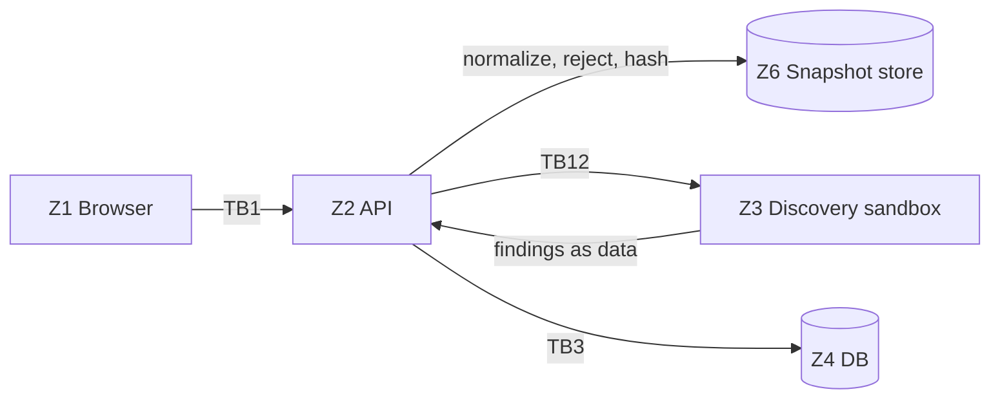
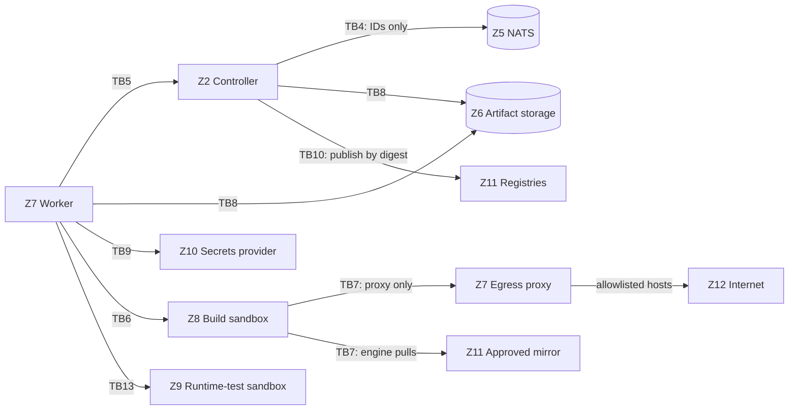
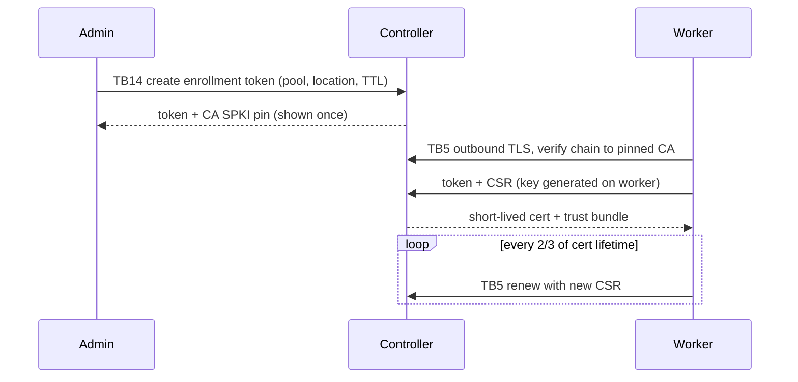

# Threat Model

Status: **Accepted, revision 2** (2026-10-19, owner decision OD-11), with a **revision 3 addendum (accepted with conditions, OD-13)** for build
secrets, Dockerfile builds, registry authentication and sensitive outputs (ADRs 0028–0031; rows TM-54 to TM-59,
TM-65 to TM-67, TM-82 to TM-86;
OD-15 findings TM-87 to TM-89, mitigated per OD-16 to OD-18). Revision 2 adds:
- trust-boundary definitions;
- evidence from the isolation spike;
- the egress and identity designs;
- a guarantees-versus-risk-reduction section for worker compromise;
- concrete test IDs.

This document is the authoritative threat analysis. Requirements are in [`security.md`](security.md). Decisions
are in ADRs 0013, 0014, 0024, 0025 and 0026. Spike evidence is in
[`../spikes/buildkit-isolation.md`](../spikes/buildkit-isolation.md). The mapping from test IDs to implementation
is in [`../developers/security-test-catalog.md`](../developers/security-test-catalog.md).

**Nothing here is implemented.** A mitigation counts as implemented only when its catalog tests exist and pass in CI
at the milestone gate.

Scope: all-in-one and single-controller topologies with remote workers (M1–M10), and controller clusters (TB15,
M11). Federation is added with its protocol.

## Assumptions

- Every uploaded source, its dependencies and anything it downloads during a build are hostile.
- Authenticated developers may be malicious or compromised. Authentication proves identity, not intent.
- A worker can be compromised through a sandbox escape. Nothing a compromised worker produces is trustworthy
  (see "Worker compromise").
- The controller host, its database and its configuration are trusted. Controller compromise is total compromise;
  the design limits what is stored there.
- Administrators are trusted but audited. Insider misuse is detected, not prevented.
- Networks between components are hostile; partitions and replays are normal.

## Assets

| ID | Asset | Property that matters most |
|---|---|---|
| A1 | Uploaded sources and snapshots | Confidentiality (team-scoped) and integrity |
| A2 | Secret values, registry credentials, cloud roles, signing keys, internal CA key | Confidentiality |
| A3 | Built images, SBOMs, signatures, attestations | Integrity |
| A4 | Spec revisions and build plans | Integrity |
| A5 | Approvals, exceptions, policies | Integrity, non-repudiation |
| A6 | Audit log | Integrity, completeness |
| A7 | Sessions, API tokens, enrollment tokens, worker certificates | Confidentiality |
| A8 | Build and test logs | Confidentiality (may echo secrets) |
| A9 | Build caches | Integrity (poisoning), confidentiality |
| A10 | Controller, queue and worker capacity | Availability |

## Threat actors

| ID | Actor | Typical goal |
|---|---|---|
| T1 | Malicious uploader (authenticated developer or stolen account) | Escape the sandbox, steal secrets or other teams' data, poison images or caches |
| T2 | Malicious dependency or upstream package | Same as T1, triggered during a legitimate build |
| T3 | Compromised worker | Read other jobs' data, forge results, pivot |
| T4 | Network attacker | Intercept, replay or inject traffic |
| T5 | Cross-team insider | Read or change another team's projects, images or destinations |
| T6 | Holder of a stolen credential (session, API/CI token, enrollment token) | Act as the victim |
| T7 | Malicious or compromised registry or mirror | Serve tampered images, alter pushed content |
| T8 | Compromised external integration (Git provider, webhook sender, IdP, notification endpoint) | Trigger unauthorized builds, exfiltrate data |
| T9 | Resource exhaustion attacker (often T1) | Deny service to other teams |
| T10 | Malicious administrator | Abuse privileges without detection |

## Trust zones

| Zone | Contents | Trust |
|---|---|---|
| Z1 Client | Browser, CLI, external CI | Untrusted |
| Z2 Controller | `samuori-server` API, scheduler, publisher, discovery supervisor, outbox relay | Trusted |
| Z3 Discovery sandbox | Short-lived detector subprocess reading one snapshot | Hostile content, no network |
| Z4 Metadata DB | SQLite/PostgreSQL | Trusted, controller-only |
| Z5 Messaging | NATS JetStream | Controller-internal |
| Z6 Artifact storage | Snapshots, logs, SBOMs, unpublished images | Integrity checked by digest |
| Z7 Worker | `samuori-worker`, its egress proxy and its host or VM | Authenticated, scoped, assumed compromisable |
| Z8 Build sandbox | BuildKit-executed build steps | Hostile |
| Z9 Runtime-test sandbox | Container started for startup, health or smoke checks | Hostile |
| Z10 Credential providers | Local encrypted store, OpenBao, AWS Secrets Manager/KMS/STS, IdP, internal CA | Trusted, external |
| Z11 OCI registries and mirrors | Destinations, approved base-image mirrors | Partially trusted; verify by digest |
| Z12 Internet | Package registries and other endpoints | Untrusted |
| Z13 External integrations | Git providers, webhook senders, notification targets | Untrusted input |

## Trust boundaries

Every TB referenced in diagrams and tables is defined here.

| TB | Between | Crossing is protected by |
|---|---|---|
| TB1 | Z1 browser ↔ Z2 API | Session cookies, CSRF, TLS, server-side validation |
| TB2 | Z1 CLI or external CI ↔ Z2 API | Scoped, expiring API tokens, TLS |
| TB3 | Z2 controller ↔ Z4 database | Local socket or TLS; least-privileged DB role |
| TB4 | Z2 controller ↔ Z5 messaging | Controller-only authenticated connections; IDs-only messages (ADR 0024) |
| TB5 | Z7 worker ↔ Z2 controller | Outbound mTLS, CA pinning, leases and fencing (ADR 0026) |
| TB6 | Z7 worker ↔ Z8 build sandbox | Isolation profile (ADR 0013), engine socket reachable only by `samuori-worker` |
| TB7 | Z8/Z9 sandboxes ↔ network (Z7 proxy, Z11 mirror, Z12 internet) | Strict egress: UID-scoped firewall, allowlisting proxy, engine pulls via mirror (ADR 0025) |
| TB8 | Z2/Z7 ↔ Z6 artifact storage | Object-scoped expiring credentials, content digests |
| TB9 | Z2/Z7 ↔ Z10 credential providers | Provider authentication; job-scoped release of secrets |
| TB10 | Z2 controller ↔ Z11 registries | Admin-managed credentials (controller only), URL validation, digest verification |
| TB11 | Z13 integrations ↔ Z2 controller | Webhook signatures (inbound); URL validation and signing (outbound) |
| TB12 | Z2 controller ↔ Z3 discovery sandbox | Subprocess with no network and resource limits; output parsed as data (ADR 0024) |
| TB13 | Z7 worker ↔ Z9 runtime-test sandbox | Same isolation profile as TB6, plus non-root, no new privileges, no egress |
| TB14 | Administrators (Z1) ↔ privileged operations in Z2 | Admin RBAC, dry-run and confirmation, audit |

## Data flows

### Upload and discovery

### Build, validation and publication

### Worker enrollment and identity

## Threats and mitigations

Test IDs are defined in the security test catalog.

### TB1 — Browser to API

| ID | STRIDE | Threat | Mitigation | Tests |
|---|---|---|---|---|
| TM-01 | S | Session theft or fixation | httpOnly, Secure, SameSite cookies; rotation at login; idle and absolute timeouts that reads and polling never renew and extension never passes | SEC-AUTH-01, SEC-AUTH-11 |
| TM-02 | T | Cross-site request forgery | CSRF token on state changes; strict CORS; JSON-only APIs | SEC-AUTH-02 |
| TM-03 | S | Password guessing | argon2id; per-account and per-IP rate limits; audited lockout | SEC-AUTH-03 |
| TM-07 | I | XSS via file names, logs, detector output or YAML | No raw HTML rendering; strict CSP; ANSI stripped from logs | SEC-UI-01 |
| TM-08 | T | OIDC or LDAP login manipulation | OIDC state, nonce, PKCE, issuer and audience checks; LDAP filter escaping | SEC-AUTH-05, SEC-AUTH-06 |
| TM-09 | D | Request or upload flooding | Per-user and per-team rate limits, size limits, quotas, pagination caps | SEC-DOS-01 |
| TM-10 | T | Path traversal or absolute paths in uploads | Server-side NFC normalization; reject `..`, absolute paths, drive letters, backslashes, NUL, overlong names | SEC-UPL-01 |
| TM-11 | T | Symlink, hardlink, device, FIFO or socket entries | Rejected, never followed; snapshots hold only regular files and directories | SEC-UPL-02 |
| TM-12 | T | Case-folding or normalization collisions | Rejected under case-insensitive NFC comparison | SEC-UPL-03 |
| TM-13 | D | Archive bombs, deep nesting | Limits on size, count, depth, ratio; nested archives stored, not extracted | SEC-UPL-04 |
| TM-14 | I | Secrets or malware in uploads | Best-effort preflight warnings; never claimed exhaustive | SEC-UPL-05 |
| TM-17 | T | Snapshot altered after commit | Content addressing; digest verified on every read | SEC-UPL-06 |

### TB2 — Automation clients to API

| ID | STRIDE | Threat | Mitigation | Tests |
|---|---|---|---|---|
| TM-04 | S | Stolen API or CI token | Hashed at rest; scoped; expiring; revocable; last-use audit | SEC-AUTH-04 |

### TB1 and TB2 — Authorization (both entry points share one path, D29)

| ID | STRIDE | Threat | Mitigation | Tests |
|---|---|---|---|---|
| TM-05 | E | Cross-team access by ID guessing | Tenant scoping in the repository layer; central authz predicate; cross-team reads return 404 | SEC-RBAC-01 to SEC-RBAC-07 |
| TM-06 | E | Escalation via admin APIs | Admin routes require admin roles server-side; worker identities rejected on user and admin APIs | SEC-RBAC-08, SEC-WRK-03 |
| TM-80 | E | Shell injection via spec commands (input at TB1/TB2, executed at TB6) | Argument arrays to the engine; never a host shell; any shell runs only in Z8 | SEC-SPC-01 |
| TM-81 | I | Secret literals in specs, or ambiguous duplicate declarations | Validation rejects secret-like literals in known fields; references only; duplicate IDs and argument names rejected | SEC-SPC-02, SEC-SPC-05 |

### TB3 — Controller to database

| ID | STRIDE | Threat | Mitigation | Tests |
|---|---|---|---|---|
| TM-18 | T/E | SQL injection | Parameterized queries only; no string-built SQL | SEC-DB-01 |
| TM-19 | I | Database or backup disclosure | Secrets never stored in plaintext; local provider key kept outside the DB; encrypted backups (D27) | SEC-SEC-05, INT-BAK-01 |

### TB4 — Controller to messaging

| ID | STRIDE | Threat | Mitigation | Tests |
|---|---|---|---|---|
| TM-20 | T | Injected or tampered messages | Controller-only authenticated NATS; IDs only; consumers re-read the DB | SEC-MSG-01 |
| TM-21 | R/T | Replay or duplication | Idempotency keys; compare-and-swap transitions | CHA-MSG-01 |
| TM-22 | D | Lost message or crash after commit | Outbox relay and reconciliation | CHA-MSG-02 |

### TB5 — Worker to controller

| ID | STRIDE | Threat | Mitigation | Tests |
|---|---|---|---|---|
| TM-30 | S | Rogue worker registration | Single-use, short-lived, pool-bound enrollment tokens shown once | SEC-WRK-01 |
| TM-31 | S | Controller impersonation | Worker pins the internal CA; any serving cert must chain to it (ADR 0026) | SEC-WRK-02 |
| TM-32 | S | Stolen worker certificate | Short-lived certs bound to worker and pool; key never leaves the worker; revocation checked per request | SEC-WRK-04, SEC-ID-03 |
| TM-33 | I | Worker fetches jobs not assigned to it | Snapshot, plan and secrets served only to the current lease holder | SEC-WRK-05 |
| TM-34 | T | Stale worker overwrites a successor's results | Fencing generation on every request | CHA-LSE-01 |
| TM-57 | I | Secret requested after lease end, revocation or cancellation | Controller re-checks the lease and run state on every release; worker ends the session and cancels the solve | SEC-SEC-07, INT-SCR-02 |
| TM-83 | E | Step mounts a secret ID not authorized for the build | Worker serves only IDs listed in the plan; others fail as "unauthorized secret mount" | SEC-SCR-03 |
| TM-35 | T | Plan tampering or replay | Immutable plans served only over TB5 and checked against the lease digest; never over NATS or shared storage (ADR 0014) | SEC-PLN-01 to SEC-PLN-04 |
| TM-37 | D | Identity lifecycle dead ends (expired certs, CA rotation, restore) | CA pinning, trust bundle refresh, renewal and re-enrollment procedures (ADR 0026) | SEC-ID-01, SEC-ID-02, SEC-ID-04 to SEC-ID-06 |

### TB6 — Worker to build sandbox

| ID | STRIDE | Threat | Mitigation | Tests |
|---|---|---|---|---|
| TM-107 | S | A stolen or replayed join token lets a host join the cluster and read its key and credentials | Administrator-issued, single-use tokens valid at most an hour, stored hashed and revocable; the join goes over TLS pinned to the issuing controller; every join is audited | SEC-HA-03 |
| TM-106 | T | A compromised build VM forges its results, reads another attempt's secrets or redirects its relays | The host bounds and recomputes guest output and runs the canary itself; callbacks serve only the attempt the VM is assigned to; relay destinations are fixed by the host (ADR 0038) | SEC-ISO-11 |
| TM-40 | E | Sandbox escape to the worker | Untrusted builds only on approved and verified `vm-per-job` or `rootless-dedicated-vm` pools (ADRs 0013, 0027) | SEC-ISO-01 to SEC-ISO-03, SEC-ISO-06, SEC-ISO-09 |
| TM-41 | E | Host takeover through engine access | No host Docker socket, no privileged containers, no host mounts; engine socket reachable only by `samuori-worker`; the worker never follows links the build user planted in shared directories | SEC-ISO-03, SEC-ISO-05, SEC-ISO-10 |
| TM-39 | I/E | Channel from steps to the daemon (BuildKit telemetry socket, spike F3) | Disable or neutralize before untrusted builds are enabled | SEC-ISO-04 |
| TM-43 | I | Secret leakage into layers, cache or logs | Secret mounts only; never build args; log masking | SEC-SEC-01 to SEC-SEC-03 |
| TM-56 | I | Secrets via build arguments, `ENV` or image history | Samuori never passes secrets as args or env; secret-looking args need user confirmation, and admin policy can reject them regardless; history and config are scanned | SEC-SEC-06, SEC-SPC-04 |
| TM-58 | I | Secret material left after failed, cancelled or timed-out builds | Values only in worker memory and step tmpfs; environment destroyed or scrubbed on every outcome; cleanup recorded | SEC-SEC-08 |
| TM-84 | I | Secret exposed through `--mount=type=secret,env=` | Allowed with a warning; log masking; covered by the canary | SEC-SEC-03, SEC-SEC-10 |
| TM-82 | E | Malicious Dockerfile frontend (`# syntax=`) runs code inside the engine | Only admin-approved, digest-pinned frontends; others refused before scheduling | SEC-SPC-03 |
| TM-85 | I | Sensitive build outputs (data or keys derived from secrets) persisted in the final image | `sensitive-content` check: path rules, key detectors, secret canary, metadata scan; block or exception; restricted distribution (ADR 0031) | SEC-SEC-10, SEC-OUT-01 to SEC-OUT-08 |
| TM-87 | I/T | Concurrent builds on one daemon share execution of identical steps, so one build's secret shapes another's output (OD-15 S7) | One active build per daemon, enforced by the scheduler and independently by the worker (OD-16) | SEC-SEC-11, SEC-SEC-13 |
| TM-88 | I/T | Cached results computed with one secret reused by a build with another project's or a rotated secret (OD-15 S8; documented BuildKit behavior) | Reuse only within a controller-assigned, validated identical scope (project, trust domain, binding versions, policy version); workers never choose cache sources; rotation invalidates; disabled until the controls pass in CI (OD-17, OD-19, `build-cache.md`) | SEC-CCH-02 to SEC-CCH-06 |
| TM-89 | I | Secret values retained in a long-lived daemon's memory after builds (OD-15) | Fresh daemon per secret-bearing build, terminated on every outcome including crash, restart and lease expiry; `vm-per-job` preferred (OD-18). Not secure deletion | SEC-SEC-12, SEC-SEC-14 |
| TM-116 | E/T/I | Railpack (ADR 0047) runs third-party code on the worker: `railpack prepare` downloads and runs mise without verifying its checksum (v0.43.0 `core/mise/install.go`), mise downloads language runtimes, and the gateway frontend generates the build graph; a project's `railpack.json` can name other images or steps | Disabled until an administrator approves a version; the worker runs only a copy of the binary whose SHA-256 matches the approval; planning runs as the build user in the attempt's scope inside a user and mount namespace with a private mise directory, reaches the network only through the build's egress proxy and allowlist, and never runs on a controller or in discovery; the frontend is pinned by digest; every plan image must be an approved, digest-pinned builder or runtime image; empty or partial plans fail; secrets and the proxy reach steps as BuildKit secrets, never as plan variables; the image goes through every post-build check. Railpack images run as 10001:10001 through a worker-added layer unless the provider keeps root (`runAsRoot`). Residual: mise and runtime downloads are trusted as far as their TLS origins and the allowlist (no staged, digest-verified mise cache yet); with `runAsRoot`, Railpack images run as root | SEC-RPK-01 to SEC-RPK-04, SEC-RPK-08 |
| TM-44 | T | Cross-team cache poisoning | Separate daemon and cache per trust domain; no cross-domain import; clean-build option | SEC-CCH-01 |
| TM-46 | D | Resource exhaustion | Daemon-level limits; one build per daemon; daemon OOM reported as a limit breach (spike F10, F11) | SEC-DOS-02 to SEC-DOS-05, SEC-ISO-07, SEC-ISO-08 |
| TM-47 | T | Malicious dependency changes output | Lockfile-respecting installs, egress presets, scanning, SBOM, provenance | Residual (see below) |

### TB7 — Sandboxes to network

| ID | STRIDE | Threat | Mitigation | Tests |
|---|---|---|---|---|
| TM-42 | I | Metadata, internal network or worker-host access | UID-scoped firewall allows only proxy and mirror; link-local and private ranges dropped | SEC-NET-01, SEC-NET-02, SEC-NET-05 |
| TM-48 | I | Proxy bypass or non-allowlisted destinations | No direct route; proxy allowlists by ecosystem preset; tools ignoring proxy settings fail closed | SEC-NET-01, SEC-NET-06 |
| TM-49 | I | DNS exfiltration | No DNS from sandboxes; names resolved only at the proxy | SEC-NET-04 |
| TM-60 | T | Tampered base image | Engine pulls only via the approved mirror, by digest; administrator-added runtimes must be pinned and allowed by the base-image policy | SEC-NET-07, SEC-REG-01, SEC-SPC-08 |
| TM-65 | I | Mirror serves one project's private image to another, including from cache | Mirror enforces controller-issued, build-scoped token scopes on every endpoint, including cached content; fails closed when authorization is unavailable; isolated mirrors until the tests pass in CI (ADR 0030, OD-14) | SEC-REG-04, SEC-REG-07, SEC-REG-08 |
| TM-66 | I | Upstream registry credentials exposed to workers or steps | Upstream credentials held only by the mirror | SEC-REG-05 |

### TB13 — Worker to runtime-test sandbox

| ID | STRIDE | Threat | Mitigation | Tests |
|---|---|---|---|---|
| TM-45 | E | Test container escalates or reaches the network | Same profile as TB6; non-root; no new privileges; dropped capabilities; no egress; time limits | SEC-RTS-01 |

### TB8 — Artifact storage

| ID | STRIDE | Threat | Mitigation | Tests |
|---|---|---|---|---|
| TM-50 | I | Worker reads arbitrary objects | Expiring, object-scoped credentials per attempt | SEC-STO-01 |
| TM-51 | T | Artifact substitution | Content addressing and digest verification on read and publish | SEC-STO-02 |

### TB9 — Credential providers

| ID | STRIDE | Threat | Mitigation | Tests |
|---|---|---|---|---|
| TM-54 | E | Missing, unauthorized or cross-project secret binding used | Admission checks project permission, binding status, usage and pool eligibility; required-but-missing blocks before scheduling | SEC-SCR-01, SEC-SCR-02, SEC-SCR-04 |
| TM-55 | I | Secret values in records, plans, audit, API responses, previews or diagnostics | Logical IDs and binding versions only; redaction | SEC-SCR-06 |
| TM-52 | I | Broad secret access | Per-job, just-in-time release with a job-scoped credential; never persisted on workers | SEC-SEC-04, SEC-SCR-05, SEC-SCR-07 |
| TM-53 | I | Secrets in DB, logs, diagnostics or previews | References only; redaction; local provider encrypts with a key outside the DB | SEC-SEC-05 |

### TB10 — Registries

| ID | STRIDE | Threat | Mitigation | Tests |
|---|---|---|---|---|
| TM-61 | T | Destination alters content after push | Destination manifest, config and layer digests verified; signatures re-verified | SEC-REG-02 |
| TM-62 | I | SSRF via admin-entered URLs (registries, webhooks, IdP) | URL allowlist; resolve then connect to the validated IP; private and link-local ranges blocked unless allowlisted; redirect limits; an edited registry endpoint never receives a stored credential | SEC-NET-03, SEC-REG-09 |
| TM-59 | E | Publication credentials used during build execution | Push profiles resolved only on the controller; steps have no route or credentials to destinations | SEC-REG-03, SEC-WRK-08 |
| TM-67 | S/I | Private registry authentication failure handled unsafely | Explicit failure; no fallback to anonymous access or another profile | SEC-REG-06 |
| TM-63 | E | Publishing to an unauthorized destination | Authorization at request and again at `gate_check`; destination credentials held only by the controller | SEC-PUB-01, SEC-WRK-08 |
| TM-64 | T | Tag race or protected-tag overwrite | Tag rules and approvals evaluated transactionally at publish time | SEC-PUB-02 |

### TB11 — External integrations

| ID | STRIDE | Threat | Mitigation | Tests |
|---|---|---|---|---|
| TM-70 | S | Forged webhook | HMAC verification, timestamp tolerance, replay cache, size limits | SEC-HOOK-01 |
| TM-71 | E | Webhook payload used as a command | Only enqueues pre-configured pipelines; payload never reaches a shell | SEC-HOOK-02 |
| TM-72 | I | Notifications leak data | Links and summaries only; outgoing webhooks signed | SEC-NOT-01 |

### TB12 — Discovery sandbox

| ID | STRIDE | Threat | Mitigation | Tests |
|---|---|---|---|---|
| TM-15 | E | Hostile manifests exploit parsers | Subprocess with no network, read-only snapshot view, CPU, memory and time limits; parse limits; output treated as data; seccomp filter that kills other ABIs and x32 calls and refuses io_uring, namespace and kernel-subsystem calls | SEC-DSC-01, SEC-DSC-02, SEC-DSC-05 |
| TM-86 | E | Dockerfile analysis executes instructions or pulls frontends | Static parsing only, in the discovery sandbox; ambiguous results need confirmation | SEC-DSC-04 |
| TM-16 | E | Discovery executes code | Detectors never spawn processes; Railpack and CNB disabled in discovery | SEC-DSC-03 |

### TB14 — Administration and audit

| ID | STRIDE | Threat | Mitigation | Tests |
|---|---|---|---|---|
| TM-90 | R | Unattributed actions | Audit event written in the same transaction as each change | INT-AUD-01 |
| TM-91 | T | Audit tampering | Append-only at the application layer; on PostgreSQL the app role lacks UPDATE and DELETE on audit tables, and retention deletes only through an owner function that refuses events younger than 30 days and is audited; scheduled export for off-host copies; SQLite limitation documented | INT-AUD-02, INT-AUD-03 |
| TM-92 | E | Dangerous admin change | Dry-run with impact preview, confirmation, audit with reason | INT-ADM-01 |
| TM-93 | S | Bootstrap credential reuse | Single-use; disabled after the first admin exists; unsafe defaults rejected | SEC-BOOT-01 |

### TB15 — Controller cluster (ADR 0034)

Every controller holds the cluster key and is as trusted as a single controller; a compromised controller is a
compromised installation. The boundaries below are between controllers, the shared database and the shared NATS.

| ID | STRIDE | Threat | Mitigation | Tests |
|---|---|---|---|---|
| TM-94 | T | A deposed or partitioned leader keeps running singleton duties | Leader lease with an epoch; a new holder increments it; `Fenced` checks the epoch in the transaction; idempotent duties | CHA-HA-04 |
| TM-95 | S/T | A holder of NATS credentials forges controller signals (revoke, cancel, deliver) | Envelopes signed with a key derived from the cluster key and refused outside a one-minute window; signals only wake work the database authorizes; workers verify every lease with the controller | SEC-HA-01 |
| TM-96 | T/I | Shared CA material read or replaced in the database | AES-GCM with a cluster-derived key and per-name associated data; key identifier checked; revision compare-and-swap | SEC-HA-02 |
| TM-97 | D/T | A crashed controller strands work, or a recovering one overwrites its successor | Ownership columns; reclaim only from dead controllers; claim tokens and owner checks on completion; lease fencing for builds; a controller that cannot record its heartbeat fences itself and releases its workers | CHA-HA-02, CHA-HA-05, CHA-HA-07 |
| TM-98 | E | Several controllers each grant a full sign-in failure budget | Failures and lockouts in the database | SEC-AUTH-09 |
| TM-99 | T | Clock skew between controllers makes leases unreliable | Clock compared with PostgreSQL's at start and on every heartbeat; a skewed controller gives up leadership; `clock` health check | CHA-HA-06 |
| TM-100 | D | Two controllers fill one daemon slot at once | Free slots counted again under a row lock on the worker while assigning | CHA-HA-03 |
| TM-102 | S | An unregistered installation, or one with another CA, calls the federation API | Mutual TLS against the registered CA pin and organization; system roots never used; disabled peers refused | FED-02 |
| TM-103 | E | A peer builds outside what it was granted, or with this installation's secrets | Grants name a hosting project, locations and a limit; the peer acts as a developer of that project only; secret-bearing builds never delegated; the executor's admission and policies apply | FED-03, FED-06 |
| TM-104 | T | A build gets two executors after a partition, or a late peer result overwrites a decision | The originator never reassigns a delegated build; only an audited abandonment ends it, after which results are refused | FED-04, FED-05 |
| TM-105 | T | A peer substitutes the image or its validation | The image is fetched by digest and verified; the originator runs its own validation before the build counts; plans never travel (ADR 0014) | FED-01 |
| TM-101 | I/T | A stolen or altered backup archive | age encryption to offline recipients (controllers hold public keys only); manifest digests and table checksums checked before a restore is used; restore only into empty targets (ADR 0035) | INT-BAK-01 |
| TM-108 | I/E | A decommissioned host keeps Samuori's keys, certificates or database password, or reconnects | Removal drains, has the host delete everything Samuori installed, then revokes its identity; an unreachable host is revoked and reported as not confirmed wiped, with terminate advice (ADR 0045) | SEC-WRK-09 |
| TM-109 | S/I | A host that obtained a join token, or someone watching the join, receives the cluster's key and credentials without an administrator noticing | Redeeming a token only opens a join request with a verification code; the bundle is sent once, only after an administrator accepts, only to the caller proving the secret whose hash opened the request; wrong secrets look like unknown requests; requests expire within an hour; decisions are audited (ADR 0045) | SEC-HA-04 |
| TM-110 | E | A token holder joins a host that receives builds or secrets, or a moved worker keeps the trust it earned elsewhere | Portal tokens name no pool; an enrolled worker is unassigned and ineligible for every build until an administrator assigns it; self-tests count only for the current pool, so reassignment needs a new one; assignment is audited (ADR 0045) | SEC-WRK-10 |
| TM-111 | D/E | Removing a controller breaks the cluster (last controller, lost NATS majority, another member down, a rollout half done), or a removed controller keeps leading or serving | Removal is administrator-only and refused in each of those cases with the reason; the departing controller gives up the lease before its host wipes, and the epoch fences it; its membership rows are deleted and its certificate pins recorded, so it is refused at start and stops counting as alive; request and revocation are audited (ADR 0045) | SEC-HA-05, SEC-HA-06, SEC-HA-07 |
| TM-112 | S/E | The NATS system account, which can remove members from the JetStream meta group, is reached by a controller process, a worker or a network peer | The password is generated per host, readable by root only and never logged; the member stores only its bcrypt hash; connecting also needs a client certificate from the cluster CA (mutual TLS); only the root helper uses it; a compromised controller process can still ask that helper to forget a member, which it could equally do with the database and cluster key it already holds (ADR 0045) | SEC-HA-08, SEC-HA-09 |
| TM-114 | S/E | A removed controller that was not wiped, still holding NATS certificates the cluster CA signed, routes its NATS member back into the cluster and reads or injects messaging traffic | Every member's routes list exactly the current members and route TLS uses `verify_cert_and_check_known_urls`, so an incoming route from a host not in the routes is refused despite its valid certificate; the route sync never drops a route to a connected peer that was not removed, turns verification on only once every connected peer is listed, restores the previous file when a reload does not take, and restarts one member at a time (under a cluster lease) when a gossiped route to a removed host survives the reload. Residual: members named by IP address cannot be checked, so verification stays off there; the unwiped host still holds the database credentials and cluster key, so wiping or terminating it is still required (ADR 0045, OD-27) | SEC-HA-10 |
| TM-113 | T/D | An update rolls out a release no allowed key signed, an unintended downgrade, or a release that breaks hosts across the fleet | One bundle verified (structure, every checksum, SSH signature against the controller's release signers) before it is kept and again before Update; the server refuses to start while a check fails (downgrade only when explicitly allowed, audited; worker protocol major must match); controllers one at a time, workers in waves of a share of each pool; a host whose install, start or self-test fails goes back to its previous release (rollback requests only to protocol 1.3 workers) and pauses the rollout; each host still verifies its own archive (ADRs 0044, 0045) | SEC-UPD-01, SEC-UPD-02, SEC-UPD-04 |
| TM-120 | E/I | Untrusted Compose input, or a compromised conversion tool, runs code with network access or credentials and reaches the controller, a registry or a cloud account | The tool runs only on a worker eligible for untrusted builds, in a fresh environment with no secret release, mirror token or cache, as the only process of a `FROM scratch` BuildKit step with `--network=none`, read-only tool and input mounts and no proxy or build arguments; the runner drops privileges (no_new_privs, empty capability bounding set, uid 65534), empties the environment and enforces the time limit; Kompose runs with `--build none` (ADR 0048) | SEC-K8S-02 |
| TM-121 | T | A tampered or unapproved tool on a worker produces output that looks trustworthy | The worker hashes the copy that runs and refuses any SHA-256 other than the approved one before preparing an environment; the job is bound to its lease by digest; the controller refuses a report naming another tool digest and fences every call by lease generation. Residual: a compromised worker can still report anything, so all output is treated as untrusted (TM-122) | SEC-K8S-01, SEC-K8S-07 |
| TM-122 | I/E | Generated files carry credentials, or privileged settings an operator applies without noticing | Post-processing only parses: literal secret-looking values become Secret references and Secret values are removed (also in edits), privileged, host-namespace, hostPath, capability and root settings are kept and reported as errors, every object is validated against the Kubernetes 1.36 schemas, output size is bounded, and the ZIP is built from the stored revision. Residual: transformed or embedded secrets (in commands, files) are not detected; Samuori never applies files and an operator must review them | SEC-K8S-03, SEC-K8S-04, SEC-K8S-05 |
| TM-124 | E/T/I | Cloud Native Buildpacks (ADR 0047) run third-party code on the worker: the lifecycle and buildpacks from the builder image detect and build the source, download runtimes and run dependency installs; a buildpack can copy a binding into a layer; layout export is an experimental lifecycle feature; the builder names its run image by a moving tag | Disabled until an administrator approves a builder and run image, both pinned by digest and through the base-image and image-source policies; the lifecycle runs only on a worker inside the build isolation as a BuildKit build in the attempt's fresh daemon, as the builder's non-root CNB user, never on a controller or in discovery; network only through the build's egress proxy and allowlist; secrets are binding files on BuildKit secret mounts for the lifecycle step only; the worker accepts only a complete, digest-consistent single-image layout and runs the canary (including the proxy credential), runtime test, validation, SBOM and signing on it; no cache crosses builds. Residual: buildpack downloads are trusted as far as their TLS origins and the allowlist; buildpack-level SBOM content is the buildpacks' claim | SEC-CNB-01 to SEC-CNB-07 |
| TM-123 | I | Another team reads or downloads a project's conversions, which describe its services and topology | Project authorization on every call (404 for other teams), write roles for create, re-run and edit; downloads are audited (ADR 0048) | SEC-K8S-06 |
| TM-125 | E/T/I | Move2Kube (ADR 0048), unmaintained since March 2025, parses uploaded source and Compose files; it can spawn containers, run local executables, read the host's environment, copy the whole input into its output, pick defaults that expose every port, and its output varies between identical runs, dropping settings such as `privileged`; user answers become its configuration | Off until an administrator approves it with its maintenance warning shown; it runs like Kompose (TM-120) with `--disable-local-execution`, `--ignore-env`, `--qa-skip` and a Samuori configuration that fixes `spawncontainers: false`, the replicas, the cluster type and the transformer list, which Samuori's settings override; only the chosen format and the QA cache leave the step (the runner removes the rest without following links); answers are validated server-side against the last run's questions (options, typed values, no template, quote or shell characters, no host path storage, no registry logins or passwords offered); Compose files it would ignore are refused and service security settings it may drop are reported for review; its output gets the same post-processing (TM-122). Residual: parser bugs in an unmaintained tool are not fixed upstream and are contained only by the conversion step; transformer definitions in the source were not loaded in the recorded runs, which is observed behaviour, not a guarantee | SEC-M2K-01 to SEC-M2K-05 |
| TM-115 | S/I/E | A worker join code passed on the command line (shell history, process list) or pasted from a forged message enrols an attacker's host, or points a real worker at an impostor controller | The code holds only the controller worker endpoints, the public CA pin and a single-use enrollment token that expires within the hour and enrols the worker unassigned (no builds, secrets or self-test until an administrator assigns it); only administrators issue it; `samuori-join worker` refuses a malformed code and checks that a controller presents a certificate for the expected name chaining to the pinned CA before installing anything; unused tokens show as unused and an unexpected worker stays unassigned and can be removed (ADR 0045) | SEC-WRK-11 |
| TM-126 | E/I/T | A project egress allowance (ADR 0052) widens one project's egress: a developer talks an administrator into opening a destination that exfiltrates data or reaches internal services, forges the evidence that justifies it, or the access leaks to other projects or methods | Never automatic: an organization administrator other than the requester approves each request, seeing the evidence and exactly what opens for which project and method; evidence is taken server-side from stored data (a recomputed readiness item, or the denials the worker's proxy reported as structured data), never from client text beyond the justification, and every entry must be in it; loopback, link-local, metadata, multicast and unspecified addresses cannot be requested; private addresses and non-public names only as internal destinations, flagged as internal network access in the approval and on the project page (ADR 0052 amendment); public allowances stay public-only plan rules; allowances apply only to the project's builds of the listed methods and appear in the plan digest; revocation and expiry stop new plans; every step is audited. Residual: an approved public host can still receive data a build sends it (as for any allowlisted host, TM-47), and an approved internal host is reachable by the project's untrusted build steps; runs already queued keep the plan they were admitted with | SEC-NET-08 |
| TM-127 | I/T | Live build output (protocol 1.7) exposes a secret before the final log is masked, comes from a worker that no longer holds the lease, or fills the database | Builds that use secrets never stream: the worker does not send, the isolation manager drops the writer and the controller refuses output for secret-bearing runs; only the current lease and generation may append, in order, 64 KiB per chunk and 2 MiB per attempt; reconciliation deletes it when the attempt ends; the page shows it as text. Residual: a build without secrets can still print anything it reads, as its final log can | SEC-SEC-16 |
| TM-128 | I/E/R | Downloading an image (ADR 0053) takes it out of Samuori without a publication's gates; deleting a build destroys evidence or breaks a publication | Download only for project maintainers, publishers and administrators, and the project's developers when an organization administrator turns on `developerDownloads` (off by default; versioned, audited policy), only for an image whose newest validation passed and that is neither restricted nor quarantined, audited; delete only by maintainers and administrators, only for finished builds, refused while an active publication, a hold or a running validation uses the image; the record, validations and audit trail stay. Residual: a downloaded image carries no signature or provenance and can be copied anywhere, as the person could with a published one | SEC-STO-03 |
| TM-129 | T/I/E | A frontend served by Samuori's web launcher (ADR 0055): folder or API-path text injecting Dockerfile instructions; the launcher serving files outside the frontend output (source, secrets in the image) or listing folders; an unpinned or unapproved Node.js image; a launcher binary that is not Samuori's | Paths and prefixes are schema-validated and re-checked when rendering, and commands are JSON exec form; the Node.js image comes pinned from the Node.js recipe under the base-image policy; the frontend build step has no network; the launcher serves only regular files inside its root, refuses symlinks leading out and never lists directories; the worker copies its own `samuori-web` and logs its digest. Residual: the launcher digest is in the build log, not yet in the provenance; the launcher adds no TLS or security headers | SEC-SPC-09 |

## Worker compromise: guarantees versus risk reduction

Job-scoped credentials and lease fencing limit what a compromised worker can reach. **They do not make it
trustworthy.** Anything a worker produces is trusted only as far as its pool's isolation profile and the evidence
around it.

**Enforced even if a worker is compromised** (each must be proven by its test):

| Guarantee | Enforced by | Test |
|---|---|---|
| No access to user or admin APIs | Worker identities rejected outside the worker protocol | SEC-WRK-03 |
| No snapshot, plan or secret for an attempt it does not currently lease | Lease check on every fetch | SEC-WRK-05 |
| Cannot overwrite results of attempts reassigned elsewhere | Fencing generation | CHA-LSE-01 |
| Cannot publish or obtain destination registry credentials | Publication runs only in the controller (ADR 0024) | SEC-WRK-08 |
| Cannot enroll other workers or extend its own identity after revocation | Admin-only token issuance; revocation checked per request | SEC-WRK-01, SEC-ID-03 |
| Cannot alter audit records | Workers have no DB or audit access | SEC-WRK-03 |

**Reduced, not prevented:**

| Risk | Reduction |
|---|---|
| Enrolled but not eligible (unverified profile, cordoned, quarantined) | Enrollment never implies trust; eligibility re-checked at each assignment |
| Confidentiality of build-time secrets delivered to builds it runs while compromised | Delivery on demand, only for plan IDs; refused after lease end; `vm-per-job`; bindings restricted to eligible pools. Not prevented |
| Confidentiality of jobs leased to it while compromised (sources, secrets released to those jobs) | `vm-per-job` limits exposure to one job; dedicated pools per trust domain; short-lived job-scoped credentials |
| Integrity of images it builds (it can produce a malicious image that looks valid) | Provenance records worker identity (SEC-WRK-06); revoked workers' outputs are flagged and publication blocked (SEC-WRK-07); optional future rebuild-and-compare on an independent worker for high-assurance policies |
| Persistence across jobs | `vm-per-job` discards the VM after each job; dedicated VMs are recycled on a schedule |
| Poisoning of its trust domain's cache | Separate cache per trust domain; clean-build option; cache purge on quarantine |
| Lateral movement on its network | Strict egress; workers need only outbound access to the controller, mirror and proxy upstreams |

## Security and usability

Security must be operable by developers with no container expertise:

- Controls are central policy set by administrators per organization, team and pool. Developers never choose
  isolation profiles, egress rules or base-image sources.
- Safe defaults require no developer action. Ecosystem egress presets and approved mirrors are selected
  automatically from the detected stack.
- A blocked action produces a plain-language explanation on the run page: what happened, why, and who can help.
  Raw firewall or runtime errors are never the only output.
- Exceptions go through request-and-approval flows that are audited and time-limited, never through
  developer-editable settings.
- No developer-visible option can weaken isolation.

## Residual risks (accepted until revisited)

| Risk | Why it remains | Revisit |
|---|---|---|
| Kernel exploit from a rootless container | Shared kernel in `rootless-*` profiles | `vm-per-job` reduces it to hypervisor escape |
| `compose-rootless` weakens the host (spike F14) | Upstream requirement | Allowed only inside a disposable VM |
| Compromised worker forges outputs for jobs it runs | Workers must build what they are given | See "Worker compromise" |
| Compromised upstream dependency built faithfully | Samuori cannot judge dependency intent | Scanning, SBOM, policy, provenance |
| Exfiltration to an allowlisted host (e.g. publishing a package) | Host-level egress control | Internal mirrors (ADR 0025 option D) for stricter pools |
| Controller compromise | It is the authority | External secrets, least-privileged DB role, external audit shipping |
| SQLite audit rows editable with file access | No DB-level permissions | PostgreSQL where stronger audit guarantees are required |

## Conventions for code

Source code does not restate this analysis. Where a security invariant is not obvious, a one-line comment may cite
a TM ID or ADR. Tests carry their catalog ID as the subtest name (for example `t.Run("SEC-UPL-01", ...)`), not in
comments.

## Open items

- Acceptance covers the architecture only. Controls whose design is unresolved are not implemented until resolved,
  and none counts as complete until its catalog tests pass in CI.
- Spike part 2 (KVM host, OD-12) to measure `vm-per-job` latency, Kata viability, per-step limits and cleanup.
- An HA and federation section is added before M11.
